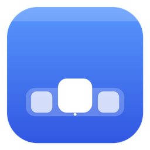

<p align="center"></p>

# DockSide

A fast, open-source macOS-style desktop shell for Windows 11, written in Rust.
Ai Assisted. Couldn't find a good alternative so I made my own.
Feel free to contribute.

Discord: https://discord.gg/AWN9STaAXx

It runs **on top of Explorer** (nothing is replaced): the Windows taskbar is
hidden while DockSide runs and is always restored when it exits.

## Features (milestone 1)

**Menu bar**
- Logo menu: About, System Settings, App Store, Force Quit, Sleep / Restart / Shut Down, Lock, Log Out
- Bold name of the focused app, plus File / Edit / View / Window / Help menus that drive the
  focused app (Copy, Paste, New Window, Minimize, Zoom, tiling, a window list, and so on)
- A tray item (the Windows "^" chevron) listing every app's notification-area icon: left click
  clicks it, right click opens the app's own tray menu
- Status items: battery, Wi-Fi, Search, Control Center and a clock, mapped to the Windows
  equivalents (Win+A, Win+S, Win+N)
- Slide across titles with a menu open, or use the arrow keys, Enter and Esc

**Dock**
- Pinned apps plus running apps, the Trash, a separator and running indicators
- macOS-style magnification (cosine falloff, cursor-anchored), a launch bounce and tooltips
- Click to launch or activate; clicking an app that's already frontmost cycles its windows
- Context menu: the app's windows, Keep in Dock, Show in Explorer, Open / Quit, Empty Trash
- Drag icons to reorder them, or drag one up out of the Dock to remove it (both are saved to config)
- Auto-hide (`autohide = true`): the Dock slides away and returns when the pointer touches the bottom edge
- Right-click the separator or an empty part of the Dock: Turn Hiding On/Off, Turn Magnification On/Off
- Config changes apply in place: editing pinned apps updates the Dock without redrawing anything else
- Store apps (`shell:AppsFolder\...`), `.lnk` shortcuts and custom PNG/ICO icons

**Finder** (everything File Explorer does, in Finder's clothes)
- Opens from the Dock's Finder icon (`path = "dockside:finder"`) or with `dockside --finder`; the Dock's Trash opens the Recycle Bin in it
- Sidebar: Favorites (Recents, Home, Desktop, Documents, Downloads, Pictures, Music, Movies, OneDrive and folders you
  "Add to Sidebar") and Locations (This PC, every drive, Network, Libraries, Recycle Bin), with macOS-style vibrancy
- Every shell location: This PC, network shares, the Recycle Bin (Put Back, Empty Trash), libraries, phones and cameras,
  zip files (browse into them), shortcuts to folders
- Path bar breadcrumbs that turn into an address field (click beside them, Ctrl+L, Alt+D, F4 or Ctrl+Shift+G): paths,
  `%VARIABLES%`, `shell:` folders, `\\server\share`, "This PC"; Tab completes; anything else runs like Explorer's Run
- Icon (any size: Ctrl+wheel, Ctrl+Plus/Minus), list (choose columns: Date Modified / Created, Size, Kind, Location),
  column and gallery views; sort by any column, group by Name / Kind / Date / Size; preview pane (Alt+P) and details pane
  (Alt+Shift+P) with the shell's properties; hidden files and file name extensions toggles
- Search below the folder (or all of This PC) as you type, with Kind / Date Modified / Size filters
  (or `kind:image date:thisweek size:large ext:pdf`)
- Right-click: Open, Open With (registered apps and "Choose Another App…"), Run as Administrator, Move to Trash,
  Delete Immediately, Get Info (Properties), Rename, Compress, Extract All, Duplicate, Make Shortcut, Quick Look, Cut,
  Copy, Paste, Copy as Path, Share, Add to Sidebar, New Folder and New ▸ file types, Undo, view options, and
  "More Options ▸" with the whole Windows menu, app extensions included (7-Zip, Git, …)
- Copy / move / delete through Windows' own progress, "Replace or Skip" and permission dialogs; Ctrl+Z / Ctrl+Y undo
  and redo moves, copies, renames, deletes (back out of the Recycle Bin), new items, shortcuts and archives
- Drag and drop to and from other apps: move on the same drive and copy across drives (Ctrl copies, Shift moves,
  Alt makes shortcuts); a right-button drag asks Move / Copy / Create Shortcuts Here
- Tabs (Ctrl+T, middle-click a folder, Ctrl+Tab), windows (Ctrl+N opens the current folder), Quick Look (Space)
- Shortcuts: macOS's with Ctrl for ⌘ plus Explorer's — Ctrl+C/X/V, Ctrl+Z/Y, Delete / Shift+Delete, F2, Alt+Enter,
  Ctrl+E / F3 search, Alt+↑ / Backspace, Alt+←/→, Ctrl+1–4 views, Ctrl+Shift+1–8 Explorer layouts, Ctrl+Shift+N,
  Ctrl+Shift+C copy as path, Ctrl+Shift+., Shift+F10 / Menu key, F5, F11, mouse back / forward buttons

**Dynamic Island**
- An always-present black pill at the top center of the menu bar that morphs between activities on
  spring physics (bouncy growth, a press squish, hover lift, cross-fades). With two activities running,
  the second splits off into a bubble beside it, like the iPhone
- Click the idle pill for the time, your next meeting and one-click timers; right-click for timers,
  the shelf and settings
- **Now Playing** from anything that reports to Windows' media controls (Spotify, browsers, Media Player):
  artwork, a waveform tinted from it, and an expanded player with scrubbing and transport controls
- **Volume and brightness HUD** in place of the Windows popups (volume keys, or scroll over the island);
  drag the bar to set the volume
- **Timer and stopwatch**: from the home panel, the right-click menu, or Spotlight ("timer 10m", "stopwatch")
- **File shelf**: drop files on the island to hold them, then drag them out where you need them
- **Upcoming meetings** from the Windows calendar, a few minutes before they start
- **Mic and camera indicators**: an orange / green dot while an app is using them, with the app's name
- **Alerts**: notifications (as banners from the island), Bluetooth devices connecting with their battery,
  screenshots (click to open, drag to use), finished downloads (with a live download activity while they run),
  charging / low battery, Caps Lock and Do Not Disturb
- **Notification stack**: page right from the home panel (or right-click › Notifications) for recent
  notifications stacked by app, in step with Windows' notification center. Click a stack to open it out,
  click a notification to open its app, and × or swipe one sideways to dismiss it
- Notifications need Windows' own Notifications switch on (Settings › System › Notifications). To see
  them only in the island, also turn on Do not disturb: it hides Windows' banners but keeps the notifications
- **Live Activities from other apps and scripts**: progress, timers and status, sent with
  `dockside activity` (see [Live Activities](#live-activities))
- Press and drag along the page dots, or drag a panel sideways, to switch between activities
- Alerts queue up and wait while you hover them; every source can be switched off in `[island]`

**Spotlight**
- Alt+Space (configurable in Settings → General, or `[spotlight] hotkey`) or the menu bar's magnifier
- Finds every app (desktop and Store) plus files and folders in Desktop, Documents, Downloads,
  Pictures, Music and Movies (indexed in the background)
- Ranks exact and prefix matches first, then word starts and initials ("vsc" → Visual Studio Code)
- Inline calculator ("12*4.5+3" → 57; Enter copies), plus a web-search fallback
- Commands: "brightness 60", "volume 30", "mute", "low power mode", "dark mode", "lock", "sleep",
  "screenshot", "task manager"… and every Windows Settings page ("bluetooth", "wallpaper", "windows update")
- LaTeX: start with `\`, "tex " or "latex " ("\alpha", "tex arrow", "latex matrix") to search ~200
  KaTeX commands with previews; Enter copies the code (for Notion equations), Shift+Enter the symbol
- Enter opens; folders open in Finder; Ctrl+Enter reveals the item in Finder; Esc clears, then closes

**Widgets**
- macOS Sonoma-style desktop widgets: frosted cards on the wallpaper, below every window
  (they stay put through Show Desktop and never pop over the app you're using)
- Clock (analog, or with the date), World Clock (one zone, four, or a list), Weather (current, hourly
  and a 5-day forecast from Open-Meteo; the place is found automatically or set in Settings), Calendar
  (month grid with your next events), Up Next, Reminders (a checklist you type into), Notes (type straight
  into the widget), Batteries (this PC plus connected Bluetooth devices), Now Playing (with transport
  controls) and System (CPU graph, memory, disk, network)
- Small, medium and large sizes; drag a widget anywhere and it snaps to the screen edges and its neighbours
- Right-click a widget to resize or remove it; add more in Settings → Widgets
- Positions live in `[[widgets.items]]`; notes and reminders in `%APPDATA%\DockSide\widgets.json`

**Desktops**
- Alt+1 … Alt+9 jump straight to that Windows virtual desktop
- Win+Ctrl+← / → switch through DockSide, and Windows' desktop-name popup is hidden
- Every switch (shortcuts, Task View, touchpad gestures) shows in the Dynamic Island with a
  sliding indicator; focus follows to the new desktop's top window
- Settings → Desktops, or `[desktops]` (uses Windows 11 24H2+'s internal desktop API)

**Platform**
- True rounded acrylic, blur and Liquid Glass via Windows.UI.Composition; glass really refracts (screen capture + a GPU bezel/lens shader), with a floating glass Finder sidebar, capsule toolbar and path bar like macOS Tahoe; the menu bar defaults to Tahoe's clear style, picking light or dark text from the wallpaper (a host backdrop brush with any corner radius), per-monitor DPI and dark/light mode that follows Windows
- Menu bar and Dock reserve screen space (Win32 AppBars), so maximized windows fit between them
- Hides itself for fullscreen apps
- Rendering uses Direct2D/DirectWrite into layered windows; animations are vsync-paced and the
  app idles at ~0% CPU

## Live Activities

Anything that can run a command can put an activity in the island:

```
dockside activity start build --title "Build" --subtitle "Compiling" --progress 0%
dockside activity update build --progress 45% --value "45/100"
dockside activity end build --subtitle "Finished"
```

Options: `--title`, `--subtitle`, `--progress` (0–1 or a percentage), `--value` (short text at the
right of the pill), `--timer SECONDS` (counts down), `--stopwatch` (counts up), `--color #RRGGBB`,
`--icon PATH` (an image or an app whose icon to show) and `--open TARGET` (a URL, file or app opened
when the expanded activity is clicked). `end` with `--subtitle` shows that message briefly. Up to 8
run at once, and one nobody updates for 12 hours is dropped.

Apps can skip the command and send the same fields as JSON (`{"op": "start", "id": "build",
"title": "Build", "progress": 0.45}`) in a `WM_COPYDATA` message with `dwData = 0xAC710001` to the
message-only window of class `DockSideSurface`; `dockside activity send '<json>'` does the same from
a script. Turn them off with `[island] live_activities = false`.

## Build & run

Requirements: Rust (stable, MSVC toolchain) and the Visual Studio C++ Build Tools.

```bash
cargo run --release
```

Quit from the logo menu (**Quit DockSide**). If it's ever killed and the taskbar stays hidden:

```bash
cargo run --release -- --restore-taskbar
```

## Settings

Open **System Settings** from the logo menu (**DockSide Settings…**), from **Dock Settings…** when
you right-click the Dock, or by launching DockSide again while it's running.

- **General:** Start DockSide at login, hide the Windows taskbar, Mac- or Windows-style shortcut hints
- **Appearance:** Auto / Light / Dark, accent color, font
- **Menu Bar:** background, logo, clock format, reserved space, status items
- **Dock:** size, magnification and magnified size, auto-hide, icon style, background,
  running apps, Trash, pinned apps (add with a file picker, remove with −)
- **Widgets:** show or hide them, background, add any widget, Weather location and units,
  World Clock time zones

"Start at login" registers the exe you're running (`HKCU\...\Run`). Use a release build
(`cargo build --release`) for that, not `target\debug`.

## Configuration

Everything Settings changes is stored in `%APPDATA%\DockSide\config.toml`, which is created on
first run with comments. Editing it by hand works too: changes apply as soon as you save, and only
the affected part of the shell redraws.

For the most faithful look, install **SF Pro Text** (or Inter) and set `font`. Give dock apps
macOS-style icons with `icon = "C:\\path\\to\\icon.png"`.

Logs: `%APPDATA%\DockSide\dockside.log`.

## Architecture

```
crates/dockside/src
├── app.rs        event loop, message routing, actions (queued, run outside borrows)
├── menubar.rs    menu bar layout, vector status glyphs
├── dock.rs       dock items, magnification layout (unit-tested), bounce, context menus
├── menu.rs       popup menus + the standard menu contents
├── finder/       Finder window (views, input), filesystem helpers, background icon loader
├── settings.rs   System Settings window
├── widgets/      desktop widgets: layout, snapping and the desktop layer; views, glyphs; weather,
│                 battery and system stat sources; notes / reminders store
├── island/       Dynamic Island: spring-driven pill, views, glyphs; media, calendar, notifications,
│                 bluetooth and system sources feed it from background threads
├── chrome.rs     shared window chrome: shadow, body, traffic lights
├── surface.rs    backdrop (DWM acrylic) window + layered content window pair
│   (win/glass.rs: Liquid Glass refraction engine)
├── gfx/          Direct2D canvas/painter, DirectWrite text, icon loading (shell + WIC)
├── anim.rs       DwmFlush-paced frame clock, damped springs
├── config.rs     TOML config: defaults merged under the user file, hot reload, toml_edit writes
├── theme.rs      light/dark palette
└── win/          Win32: AppBar, taskbar, window enumeration, system actions, accent policy
```

## Roadmap

- [x] Finder: sidebar, icon / list / column views, rename, trash, context menus
- [x] Finder: drag and drop, Quick Look (Space), tabs, search, sidebar vibrancy
- [x] Widgets: a desktop widget layer (clock, world clock, weather, calendar, up next, reminders,
      notes, batteries, now playing, system)
- [x] True rounded acrylic via `Windows.UI.Composition` host backdrop
- [x] Dock: drag to reorder, drag out to remove, auto-hide
- [ ] Dock: minimized windows, a downloads stack, multi-monitor
- [ ] Real per-app menus via UI Automation, where apps expose them
- [x] Spotlight
- [ ] Mission Control / App Exposé, Launchpad
- [x] Virtual desktop shortcuts (Alt+number) with Dynamic Island switch animations
- [x] Dynamic Island: Now Playing, HUDs, timers, shelf, calendar, notifications, device and status alerts
- [x] Dynamic Island: Live Activities from other apps, notification stack
- [ ] Dynamic Island: reply to notifications from the island
- [x] A System Settings-style GUI for the config, plus Start at login
- [x] Menu bar tray item listing every app's notification-area icon
- [x] Spotlight: LaTeX symbol lookup (for Notion equations)
- [x] Spotlight: Windows commands (brightness, volume, Low Power Mode, dark mode, lock…) and every Settings page
## Notes

- Liquid Glass refraction (`[general] glass_refraction`) hides glass surfaces, and Finder windows with a glass sidebar, from screenshots and screen sharing; turn it off in Settings → Appearance to fall back to non-bending glass.
- Blurred backdrops need Windows 11 with **Transparency effects** turned on (Settings → Personalization → Colors). If Composition isn't available, DockSide falls back to a DWM accent with 8px corners.
